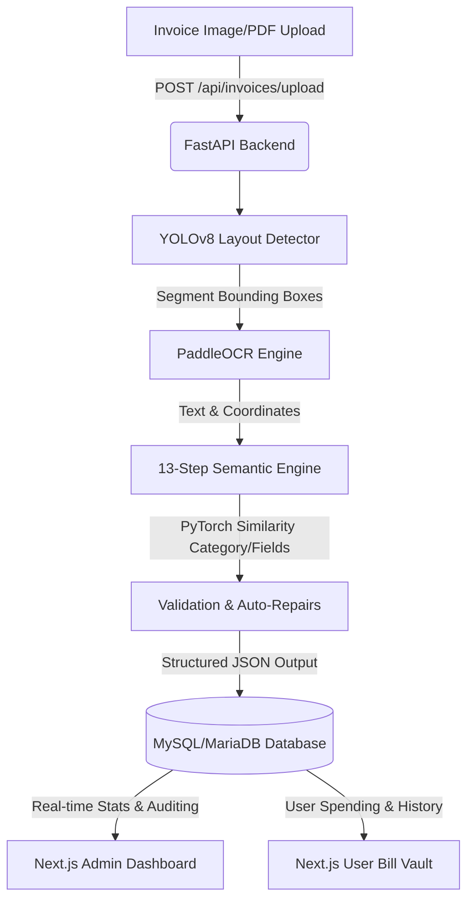

# 📊 billvalutAI

Welcome to the unified master repository for the **Aura Intelligent OCR Billing Suite**. This suite is a world-class, enterprise-grade Intelligent Document Processing (IDP) system that automates billing and invoice processing. 

By combining a high-performance **FastAPI backend** (driven by YOLOv8 layout detection and PaddleOCR text extraction) with two custom **Next.js frontend portals** (User Billing Vault & Admin Dashboard), Aura provides a comprehensive solution for invoice ingestion, validation, categorization, and business metrics tracking.

---

## 🏗️ System Architecture

The following diagram illustrates how the ingestion, processing, and visualization layers interact with the database:



---

## 📁 Repository Structure

The workspace is organized as a unified monorepo to coordinate the service layers:

```
main_phase/
├── backend/                     # Python FastAPI Backend
│   ├── app/                     # Backend Source Code
│   │   ├── api/                 # API Routes (Auth, Invoices, Admin)
│   │   ├── core/                # Configuration & Security (JWT, CORS)
│   │   ├── database/            # Database Session & SQLAlchemy Models
│   │   ├── pipeline/            # AI & OCR Pipeline Engines
│   │   ├── rules/               # Regex patterns & Keyword sets
│   │   └── utils/               # Common helper functions
│   ├── best.pt                  # Pre-trained YOLOv8 Layout weights
│   ├── requirements.txt         # Python Dependencies
│   └── .env                     # Backend Environment variables
├── frontend-user/               # Next.js User Ingestion Portal (Port 3000)
│   ├── app/                     # App Router pages (Dashboard, Upload, History)
│   ├── public/                  # Static assets & illustrations
│   ├── tailwind.config.ts       # Layout & Color definitions
│   └── package.json             # Frontend packages
├── frontend-admin/              # Next.js Enterprise Admin Dashboard (Port 3001)
│   ├── app/                     # App Router pages (Users, Health, Analytics)
│   ├── components/              # Premium visual components & Chart widgets
│   ├── store/                   # Zustand state management
│   └── package.json             # Admin packages
├── package.json                 # Unified Workspace scripts
└── README.md                    # This master documentation
```

---

## 🤖 Deep-Dive: AI Extraction Pipeline

The core intelligence resides in `backend/app/pipeline/`. When an invoice image is uploaded, it goes through a **13-Step Ingestion & Intelligence Pipeline** managed by the `SemanticEngine`:

```
[Upload] ➔ 1. OCR Line Analysis ➔ 2. Doc Type Detection ➔ 3. Vendor Extraction
         ➔ 4. Customer Extraction ➔ 5. Invoice Details ➔ 6. Tax Extraction
         ➔ 7. Amount Extraction ➔ 8. Payment Info ➔ 9. Product Table Extraction
         ➔ 10. Category Classification ➔ 11. Business Validation ➔ 12. Confidence Scoring
         ➔ 13. Output JSON Formatting
```

### The 13 Pipeline Steps
1. **OCR Line Analysis**: Sorts and groups OCR bounding boxes into distinct physical rows based on $y$-coordinate tolerances to preserve horizontal text reading.
2. **Document Type Detection**: Analyzes keyword densities to determine if the document is an `INVOICE`, `RECEIPT`, or `BILL`.
3. **Vendor Extraction**: Identifies the vendor/merchant name using frequency analysis, layout hierarchy (top of the page), and regex exclusions.
4. **Customer Extraction**: Extracts billing details of the customer/purchaser (e.g., "Bill To" segments).
5. **Invoice Details**: Extracts invoice number, date, and due date using structured regular expressions and proximity mappings.
6. **Tax Extraction**: Resolves tax details (CGST, SGST, IGST, and total tax amount).
7. **Amount Extraction**: Locates key billing numbers (Subtotal, Total, Balance Due, and Amount Paid).
8. **Payment Information**: Identifies payment methods (Cash, Credit Card, UPI, Net Banking) and extracts transaction IDs.
9. **Product Table Extraction**: Reconstructs tabular rows, matching item descriptions, quantities, unit prices, and row totals.
10. **Category Classification**: Classifies the bill into business categories (e.g., Software, Food, Travel) using a PyTorch NLP classifier.
11. **Business Validation & Auto-Repairs**: Runs cross-field rules to auto-correct OCR errors:
    *   *CGST + SGST* must equal *Tax Amount*.
    *   *Subtotal + Tax Amount* must equal *Grand Total*.
    *   Ensures invoice dates are not in the future.
12. **Confidence Scoring**: Evaluates extraction reliability based on OCR engine confidence and spatial match consistency.
13. **Output JSON Formatting**: Maps the final validated and typed fields into standard output structures for the database.

---

## 🧠 PyTorch-Powered NLP Classification

Aura does not rely on simple, fragile keyword matches. Instead, it utilizes two dedicated **PyTorch Tensor classifiers** in `semantic_engine.py` to match unstructured terms against database standards using **Cosine Similarity**:

### 1. Spending Category Classifier (`CategoryNLPClassifier`)
Converts the full invoice text into a normalized frequency vector across a custom vocabulary, then calculates the cosine similarity matrix against 11 pre-defined category vectors:

| Category | Typical Keywords |
| :--- | :--- |
| **Travel** | travel, flight, ticket, airline, cab, taxi, uber, ola |
| **Fuel** | fuel, petrol, diesel, gas, station, filling |
| **Food** | restaurant, food, dining, cafe, caterer, eats, meal, coffee, lunch |
| **Medical** | medical, pharmacy, hospital, doctor, medicine, healthcare, clinic |
| **Software** | software, saas, subscription, cloud, aws, gcp, azure, hosting |
| **Marketing** | marketing, ads, facebook ads, google ads, promotion |
| **Utilities** | utility, electricity, water, power, telecom, broadband, phone |
| **Electronics** | electronics, laptop, mobile, charger, keyboard, mouse, monitor |
| **Subscription** | subscription, monthly, yearly, netflix, spotify, zoom |
| **Entertainment** | entertainment, movie, ticket, event, show, cinema |
| **Office Supplies** | stationery, paper, pen, office, printing, clothing, shirts (Default fallback) |

### 2. Schema Label Alignment Classifier (`FieldNLPClassifier`)
Matches arbitrary layout labels found on the invoice (e.g., `"INV NO"`, `"BAL DUE"`, `"TAXABLE VALUE"`) to normalized database column keys by aligning their semantic vectors in real-time.

---

## 🛢️ Database Schema & Models

The system runs on **MySQL / MariaDB** managed via **SQLAlchemy**. The schema consists of four core tables:

### 1. Users Table (`users`)
Tracks registered users, permissions, and security tokens.
*   `id` (INT, Primary Key, Auto-increment)
*   `name` (VARCHAR(100), Required)
*   `email` (VARCHAR(100), Unique, Indexed)
*   `password_hash` (VARCHAR(255), Required)
*   `plan` (VARCHAR(50), Default: `"Free"`) — Available options: `Free`, `Basic`, `Pro`, `Enterprise`
*   `status` (VARCHAR(50), Default: `"active"`)
*   `is_admin` (BOOLEAN, Default: `FALSE`)
*   `otp_code` (VARCHAR(6), Nullable) — Used for secure email login
*   `otp_expires_at` (DATETIME, Nullable)
*   `created_at` (DATETIME, Default: UTC Now)

### 2. Bills Table (`bills`)
Stores complete details of processed documents, including validation parameters.
*   `id` (INT, Primary Key, Auto-increment)
*   `user_id` (INT, ForeignKey -> `users.id`, Cascade on Delete)
*   `merchant_name` (VARCHAR(150), Nullable)
*   `invoice_total` (FLOAT, Default: `0.0`)
*   `tax_amount` (FLOAT, Default: `0.0`)
*   `cgst_amount` (FLOAT, Default: `0.0`)
*   `sgst_amount` (FLOAT, Default: `0.0`)
*   `igst_amount` (FLOAT, Default: `0.0`)
*   `invoice_number` (VARCHAR(100), Nullable)
*   `invoice_date` (VARCHAR(100), Nullable)
*   `gst_number` (VARCHAR(100), Nullable)
*   `subtotal` (FLOAT, Default: `0.0`)
*   `payment_method` (VARCHAR(100), Nullable)
*   `transaction_id` (VARCHAR(100), Nullable)
*   `notes` (TEXT, Nullable)
*   `confidence_score` (FLOAT, Default: `1.0`)
*   `image_url` (TEXT, Nullable)
*   `raw_ocr` (TEXT, Nullable)
*   `category` (VARCHAR(100), Default: `"Office"`)
*   `status` (VARCHAR(50), Default: `"processed"`) — Options: `processed`, `review`, `failed`
*   `due_date` (VARCHAR(100), Nullable)
*   `payment_terms` (VARCHAR(100), Nullable)
*   `balance_due` (FLOAT, Default: `0.0`)
*   `amount_paid` (FLOAT, Default: `0.0`)
*   `payment_status` (VARCHAR(50), Default: `"UNKNOWN"`) — Values: `PAID`, `UNPAID`, `PARTIALLY_PAID`, `OVERDUE`, `CANCELLED`
*   `status_reason` (TEXT, Nullable)
*   `created_at` (DATETIME, Default: UTC Now)

### 3. System Activities Table (`system_activities`)
Audits admin and system logs.
*   `id` (INT, Primary Key)
*   `user_id` (INT, ForeignKey -> `users.id`, Set Null on Delete)
*   `user_name` (VARCHAR(100), Nullable)
*   `activity_type` (VARCHAR(50), Required) — e.g., `UPLOAD`, `AUTH`, `SYSTEM_UPDATE`
*   `message` (TEXT, Required)
*   `created_at` (DATETIME, Default: UTC Now)

### 4. Feedbacks Table (`feedbacks`)
Maintains user satisfaction scores.
*   `id` (INT, Primary Key)
*   `user_id` (INT, ForeignKey -> `users.id`)
*   `user_name` (VARCHAR(100), Nullable)
*   `user_email` (VARCHAR(100), Nullable)
*   `rating` (INT, Required) — 1 to 5 scale
*   `comment` (TEXT, Nullable)
*   `created_at` (DATETIME, Default: UTC Now)

---

## 🎨 Portals & Features

### 1. User Ingestion Portal (`frontend-user`)
Designed as a modern, emerald/cyan glassmorphic interface where customers manage their invoices:
*   **Animated Splash Screen**: Features glowing scan effects and floating sample cards.
*   **Interactive Drag & Drop Upload**: Instant previews with scanning laser beams and real-time bounding box visualization overlays.
*   **Interactive Analytics**: Tracks monthly spending distributions and categories using responsive **Recharts** widgets.
*   **Confidence Slider & Metadata Editor**: Allows inline corrections of fields detected by the AI.
*   **Email OTP Authentication**: Passwordless login using verification codes.

### 2. Admin Dashboard (`frontend-admin`)
An enterprise-grade control center to monitor pipeline throughput and infrastructure:
*   **8 Real-time KPI Cards**: Monitors total users, premium conversions, OCR queue backlogs, average extraction accuracy, and server uptime.
*   **Live OCR Processing Queue**: Shows active jobs, pipeline confidence margins, and tasks flagged for manual review.
*   **Detailed AI Extraction Metrics**: Tracks accuracy levels down to the field level (e.g., Invoice Number at 99.2%, Vendor Name at 96.8%).
*   **System Health Dashboard**: Real-time graphs for CPU load, RAM usage, database latency, and endpoint performance logs.

---

## ⚙️ Environment Configuration

### Backend Environment Variables (`backend/.env`)
Create a `.env` file inside the `backend/` directory with the following variables:
```env
# Database Configurations
DB_HOST=localhost
DB_PORT=3306
DB_USER=root
DB_PASS=your_db_password
DB_NAME=aura_idp

# SMTP Configurations for Email OTP Verification
SMTP_HOST=smtp.gmail.com
SMTP_PORT=587
SMTP_USER=your_email@gmail.com
SMTP_PASS=your_app_password
SMTP_FROM=your_email@gmail.com
```

### User Frontend Environment Variables (`frontend-user/.env.local`)
```env
NEXT_PUBLIC_API_URL=http://localhost:8000
```

### Admin Frontend Environment Variables (`frontend-admin/.env.local`)
```env
NEXT_PUBLIC_API_URL=http://localhost:8000
```

---

## 🚀 Getting Started & Orchestration

Aura is orchestrated from the workspace root. You can run all three layers (FastAPI Backend, User Frontend, Admin Frontend) concurrently.

### 📋 Prerequisites
Ensure you have the following installed on your machine:
*   **Node.js** (v18.x or v20.x+)
*   **Python** (v3.9 to v3.12)
*   **MySQL / MariaDB** server running on port `3306`

---

### 🛠️ Step-by-Step Installation

#### Step 1: Install Node Dependencies
Run the workspace helper script from the root folder to install packages for the root runner and both frontends:
```bash
npm run install-all
```

#### Step 2: Set Up Backend Virtual Environment
Navigate to the `backend/` directory, set up your Python virtual environment, and install libraries:
```bash
cd backend

# Create the virtual environment
python -m venv .venv

# Activate the environment:
# On Windows (PowerShell):
.venv\Scripts\Activate.ps1
# On macOS/Linux:
source .venv/bin/activate

# Install requirements
pip install -r requirements.txt
```

> [!IMPORTANT]
> Ensure the YOLOv8 layout model weights file named **`best.pt`** is placed directly in the `backend/` root directory. It is required for layout classification when starting the backend.

---

### 💻 Running the Suite

You can launch all services in development mode with a single command from the workspace root:
```bash
# Return to the workspace root directory
cd ..

# Run concurrent services
npm run dev
```

This launches:
*   **FastAPI Backend**: `http://localhost:8000` (Interactive docs: `http://localhost:8000/docs`)
*   **User Billing Portal**: `http://localhost:3000`
*   **Admin Dashboard**: `http://localhost:3001`

---

### 🔌 Running Components Separately
If you need to test components in isolation:
*   **Backend API Server**: `npm run backend-dev`
*   **User Portal**: `npm run frontend-user-dev`
*   **Admin Console**: `npm run frontend-admin-dev`

---

## 🛠️ Troubleshooting

*   **Warmup Delay**: On the very first upload, the backend loads the YOLOv8 model weights (`best.pt`) and initializes PaddleOCR models. This compilation step can take up to 30 seconds. Subsequent document processing requests typically complete in `1 to 3 seconds`.
*   **Database Sync**: If you run into SQLAlchemy errors, verify that your MySQL server is running and the database name matches `DB_NAME` in `backend/.env`.
*   **CORS Policies**: The backend is configured to accept requests from `http://localhost:3000` (User Frontend) and `http://localhost:3001` (Admin Frontend). If running on custom ports, update the CORS origins in `backend/app/core/config.py`.
