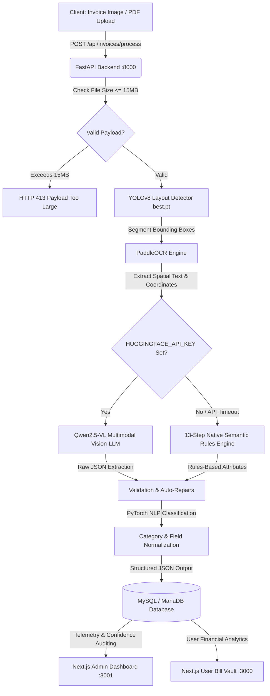

# 📊 BillVaultAI (Aura Billing Suite)

[](https://github.com/)
[](https://fastapi.tiangolo.com/)
[](https://nextjs.org/)
[](https://pytorch.org/)
[](https://docs.ultralytics.com/)
[](https://www.mysql.com/)
[](https://www.typescriptlang.org/)
[](https://tailwindcss.com/)

> **BillVaultAI** (Aura Billing Suite) is an enterprise-grade, end-to-end **Intelligent Document Processing (IDP) and Financial Analytics System**. It automates invoice ingestion, validation, layout detection, and analytical breakdowns, turning unstructured receipts and bills into structured, verified, auditable financial records.

---

## 📋 Table of Contents

- [🌟 Overview](#-overview)
- [✨ Key Features](#-key-features)
- [🏗️ System Architecture](#%EF%B8%8F-system-architecture)
- [📁 Repository Structure](#-repository-structure)
- [🤖 AI Extraction Pipeline](#-ai-extraction-pipeline)
  - [1. Qwen2.5-VL Multimodal Vision-LLM Engine](#1-ai-enhanced-extraction-qwen25-vl-72b-instruct)
  - [2. 13-Step Native Semantic Rules Engine (Offline Fallback)](#2-native-rules-based-extraction-semanticengine)
- [🧠 PyTorch NLP Classifiers](#-pytorch-powered-nlp-classification)
- [🛢️ Database Schema & Models](#%EF%B8%8F-database-schema--models)
- [🎨 Applications & Dashboards](#-applications--dashboards)
  - [1. User Billing Portal (frontend-user)](#1-user-billing-portal-frontend-user)
  - [2. Admin Operations Dashboard (frontend-admin)](#2-admin-operations-dashboard-frontend-admin)
- [🔌 API Endpoint Reference](#-api-endpoint-reference)
- [🔒 Security & Production Hardening](#-security--production-hardening)
- [⚙️ Environment Configuration](#%EF%B8%8F-environment-configuration)
- [🚀 Quickstart & Local Development](#-quickstart--local-development)
- [🚢 Production Deployment Guide](#-production-deployment-guide)
- [🛠️ Troubleshooting & FAQs](#%EF%B8%8F-troubleshooting--faqs)

---

## 🌟 Overview

**BillVaultAI** eliminates manual data entry by extracting structured, verified JSON data from complex invoices, tax bills, and retail receipts.

The platform is architected as a modular, production-ready monorepo:
1. **FastAPI Backend (`backend`)**: The high-throughput AI engine handling image preprocessing, YOLOv8 layout detection, PaddleOCR text extraction, PyTorch NLP categorization, and multimodal Vision-LLM fallback logic.
2. **User Billing Portal (`frontend-user`)**: A high-performance, glassmorphic Next.js 14 web app (Port 3000) for receipt uploads, live laser-scan tracking, interactive field verification, and real-time spending analytics.
3. **Enterprise Admin Dashboard (`frontend-admin`)**: A dedicated Next.js 16 enterprise control center (Port 3001) for system telemetry, live inference queues, data confidence audits, OCR logs, user management, and server health tracking.

---

## ✨ Key Features

- 🎯 **YOLOv8 Layout Segmentation**: Auto-detects invoice headers, table items, tax footers, and merchant logos.
- 🔠 **PaddleOCR Text Ingestion**: Extracts bounding boxes, text lines, and spatial coordinates with sub-millisecond geometry clustering.
- 🧠 **Dual Extraction Engine**:
  - **Primary**: Multimodal Vision-LLM (`Qwen2.5-VL-72B-Instruct`) via Hugging Face Serverless API.
  - **Fail-Safe Fallback**: Local 13-Step PyTorch & Regex `SemanticEngine` operating with zero external API dependencies.
- 📐 **PyTorch Cosine-Similarity Classifiers**: Categorizes expenses into 11 business categories and aligns layout labels to standardized database fields.
- 🔒 **Zero-Trust Role-Based Authentication**:
  - Secure Passwordless OTP auth via SMTP.
  - JWT token auth with explicit `is_admin` permission checks.
  - Dedicated `/login` portal for administrators with no auto-login backdoors.
- 🛡️ **DoS & Abuse Protection**: Enforced 15MB file upload ceiling returning HTTP 413, dynamic CORS origin whitelisting, and rate-limiting safeguards.
- 📊 **Real-time Financial Analytics**: Interactive charts using Recharts for monthly spend tracking and category distributions.
- 🖥️ **Full Observability Admin Suite**: Live CPU/RAM charts, database query latency tracking, and confidence score audit trails.

---

## 🏗️ System Architecture



---

## 📁 Repository Structure

```
main_phase/
├── backend/                     # Python FastAPI Backend (Port 8000)
│   ├── app/
│   │   ├── api/routes/          # REST API Endpoints (auth.py, invoices.py, admin.py)
│   │   ├── core/                # Config, JWT Security, CORS, Lifespan hooks
│   │   ├── database/            # SQLAlchemy Database Engine & ORM Models
│   │   ├── pipeline/            # YOLOv8, PaddleOCR & Semantic Extraction Pipeline
│   │   ├── rules/               # Regex patterns & Keyword dictionaries
│   │   └── utils/               # File handlers, SMTP mailer, logging
│   ├── best.pt                  # Pre-trained YOLOv8 Layout weights
│   ├── requirements.txt         # Python dependencies
│   ├── .env.example             # Documented production environment template
│   └── uploads/                 # Static storage for uploaded bills
├── frontend-user/               # Next.js 14 User Portal (Port 3000)
│   ├── app/                     # App router pages (dashboard, upload, bill/[id], analytics)
│   ├── components/              # UI components (Scanner beam, Navbar, Cards)
│   ├── lib/api.ts               # Centralized dynamic API client (Zero hardcoded URLs)
│   ├── .env.example             # Production frontend configuration template
│   └── package.json
├── frontend-admin/              # Next.js 16 Admin Control Center (Port 3001)
│   ├── app/                     # Admin pages (login, system, users, invoices, ocr, api)
│   ├── components/              # Dashboard charts, metrics cards, Sidebar, Header
│   ├── lib/api.ts               # Centralized dynamic admin API client
│   ├── .env.example             # Production admin configuration template
│   └── package.json
├── package.json                 # Monorepo orchestration scripts
└── README.md                    # Master documentation
```

---

## 🤖 AI Extraction Pipeline

Document processing follows an intelligent dual-mode path inside `backend/app/pipeline/`:

### 1. AI-Enhanced Extraction (Qwen2.5-VL-72B-Instruct)
When `HUGGINGFACE_API_KEY` is provided, the backend leverages `Qwen/Qwen2.5-VL-72B-Instruct` via Hugging Face Serverless API:
* **Multimodal Spatial Reasoning**: Combines visual layout geometry with text coordinates to parse irregular, multi-column invoices and tilted receipts.
* **Schema Enforcement**: Guarantees JSON output conformant to system entities.
* **Boundary Clamping**: Automatically sanitizes string fields (e.g. notes and terms) to database column limits.

### 2. Native Rules-Based Extraction (SemanticEngine)
If Hugging Face is unconfigured, rate-limited, or network-disconnected, the pipeline falls back to an offline **13-Step Ingestion & Intelligence Engine**:

```
[Upload] ➔ 1. OCR Line Clustering ➔ 2. Doc Type Detection ➔ 3. Vendor Extraction
         ➔ 4. Customer Extraction  ➔ 5. Invoice Metadata   ➔ 6. Tax Separation
         ➔ 7. Totals & Balance     ➔ 8. Payment Method     ➔ 9. Item Table Extraction
         ➔ 10. PyTorch Category    ➔ 11. Math Validation   ➔ 12. Confidence Scoring
         ➔ 13. Output JSON Formatting
```

#### The 13 Pipeline Steps
1. **OCR Line Analysis**: Clusters OCR bounding boxes into lines based on $y$-coordinate tolerances.
2. **Document Type Detection**: Analyzes document header keywords (`INVOICE`, `RECEIPT`, `TAX INVOICE`, `BILL`).
3. **Vendor Extraction**: Detects merchant/vendor names using layout hierarchy and exclusion filters.
4. **Customer Extraction**: Isolates "Bill To" / purchaser blocks.
5. **Invoice Details**: Parses invoice number, bill date, and due date with regex patterns.
6. **Tax Extraction**: Isolates CGST, SGST, IGST, and total tax values.
7. **Amount Extraction**: Resolves Subtotal, Grand Total, Amount Paid, and Balance Due.
8. **Payment Information**: Identifies payment methods (UPI, Card, Cash, Net Banking) and transaction references.
9. **Product Table Extraction**: Reconstructs line items, descriptions, quantities, unit prices, and row totals.
10. **Category Classification**: Classifies documents into business expense categories via PyTorch NLP.
11. **Business Validation**: Validates math integrity (`Subtotal + Tax == Grand Total`, `CGST + SGST == Total Tax`).
12. **Confidence Scoring**: Evaluates reliability scores based on spatial alignment, contrast, and OCR quality.
13. **Output JSON Formatting**: Maps validated attributes into standard database entities.

---

## 🧠 PyTorch-Powered NLP Classification

Aura uses two dedicated **PyTorch Tensor Classifiers** utilizing **Cosine Similarity**:

### 1. Expense Category Classifier (`CategoryNLPClassifier`)
Normalizes invoice text and evaluates cosine similarity against 11 pre-computed category vectors:

| Category | Typical Associated Keywords |
| :--- | :--- |
| **Travel** | travel, flight, ticket, airline, cab, taxi, uber, ola |
| **Fuel** | fuel, petrol, diesel, gas, station, filling |
| **Food** | restaurant, food, dining, cafe, caterer, eats, meal, coffee |
| **Medical** | medical, pharmacy, hospital, doctor, medicine, healthcare |
| **Software** | software, saas, subscription, cloud, aws, gcp, azure, hosting |
| **Marketing** | marketing, ads, facebook ads, google ads, promotion |
| **Utilities** | utility, electricity, water, power, telecom, broadband |
| **Electronics** | electronics, laptop, mobile, charger, keyboard, monitor |
| **Subscription** | subscription, monthly, yearly, netflix, spotify, zoom |
| **Entertainment** | entertainment, movie, ticket, event, show, cinema |
| **Office Supplies** | stationery, paper, pen, office, printing (Default) |

### 2. Schema Label Alignment Classifier (`FieldNLPClassifier`)
Maps non-standard document labels (e.g., `"INV NO"`, `"BAL DUE"`, `"TAXABLE VALUE"`) to normalized database keys in real time.

---

## 🛢️ Database Schema & Models

Built on **MySQL / MariaDB** managed via **SQLAlchemy**:

### 1. `users` Table
- `id` (INT, Primary Key)
- `name` (VARCHAR(100))
- `email` (VARCHAR(100), Unique, Indexed)
- `password_hash` (VARCHAR(255))
- `plan` (VARCHAR(50), Default: `"Free"`)
- `status` (VARCHAR(50), Default: `"active"`)
- `is_admin` (BOOLEAN, Default: `FALSE`)
- `otp_code` (VARCHAR(6), Nullable)
- `otp_expires_at` (DATETIME, Nullable)
- `created_at` (DATETIME)

### 2. `bills` Table
- `id` (INT, Primary Key)
- `user_id` (INT, Foreign Key -> `users.id`)
- `merchant_name` (VARCHAR(150))
- `invoice_number` (VARCHAR(100))
- `invoice_date` (VARCHAR(100))
- `due_date` (VARCHAR(100))
- `gst_number` (VARCHAR(100))
- `subtotal` (DOUBLE)
- `tax_amount` (DOUBLE)
- `cgst_amount` (DOUBLE)
- `sgst_amount` (DOUBLE)
- `igst_amount` (DOUBLE)
- `invoice_total` (DOUBLE)
- `amount_paid` (DOUBLE)
- `balance_due` (DOUBLE)
- `payment_method` (VARCHAR(100))
- `transaction_id` (VARCHAR(100))
- `payment_status` (VARCHAR(50))
- `category` (VARCHAR(100))
- `confidence_score` (DOUBLE)
- `image_url` (TEXT)
- `raw_ocr` (TEXT)
- `status` (VARCHAR(50)) — (`processed`, `review`, `failed`)
- `created_at` (DATETIME)

### 3. `system_activities` Table
- `id` (INT, Primary Key)
- `user_id` (INT, Foreign Key)
- `user_name` (VARCHAR(100))
- `activity_type` (VARCHAR(50))
- `message` (TEXT)
- `created_at` (DATETIME)

### 4. `feedbacks` Table
- `id` (INT, Primary Key)
- `user_id` (INT, Foreign Key)
- `user_name` (VARCHAR(100))
- `user_email` (VARCHAR(100))
- `rating` (INT, 1-5)
- `comment` (TEXT)
- `created_at` (DATETIME)

---

## 🎨 Applications & Dashboards

### 1. User Billing Portal (`frontend-user`)
* **URL**: `http://localhost:3000`
* **Features**:
  - Drag-and-drop document upload with animated laser-scan beam.
  - Interactive split-screen review (`/bill/[id]`) showing original bill image and editable extracted fields with instant recalculation.
  - Spending trends and category analytics powered by Recharts (`/analytics`).
  - Invoice history with real-time status filtering and search (`/history`).
  - Secure passwordless OTP email authentication (`/login`).

### 2. Admin Operations Dashboard (`frontend-admin`)
* **URL**: `http://localhost:3001`
* **Dedicated Login**: `http://localhost:3001/login`
* **Features**:
  - **Zero Auto-Login**: Full authentication protection with JWT access tokens and `is_admin` role verification.
  - **System Telemetry (`/system`)**: Real-time CPU usage, RAM utilization, and response latency charts.
  - **OCR Stream & Confidence Log (`/ocr`)**: Live spatial inspection of bounding box coordinates and OCR engine confidence.
  - **AI Extraction Diagnostics (`/ai-extraction`)**: Model performance, fallback frequency, and prompt token usage.
  - **Invoice Management (`/invoices`)**: Organization-wide view of all submitted bills with bulk approval/rejection.
  - **User Administration (`/users`)**: User plan controls, account status toggle, and role management.
  - **Interactive API Documentation (`/api`)**: Complete live endpoint testing sandbox.

---

## 🔌 API Endpoint Reference

### Authentication Routes (`/api/auth`)
| Method | Endpoint | Description | Auth Required |
| :--- | :--- | :--- | :---: |
| `POST` | `/api/auth/send-otp` | Generate and email a 6-digit OTP code | No |
| `POST` | `/api/auth/verify-otp` | Verify OTP code and return JWT access token | No |
| `POST` | `/api/auth/login` | Email + Password authentication (User or Admin) | No |
| `POST` | `/api/auth/google` | Google OAuth2 token verification | No |
| `GET` | `/api/auth/me` | Fetch authenticated user profile & permissions | Yes (Bearer) |

### Invoice Processing Routes (`/api/invoices`)
| Method | Endpoint | Description | Auth Required |
| :--- | :--- | :--- | :---: |
| `POST` | `/api/invoices/process` | Upload & run full IDP extraction pipeline (max 15MB) | Yes (Bearer) |
| `POST` | `/api/invoices/process/document`| API documentation alias for invoice processing | Yes (Bearer) |
| `GET` | `/api/invoices/` | List all invoices for the authenticated user | Yes (Bearer) |
| `GET` | `/api/invoices/{id}` | Retrieve single invoice details & items | Yes (Bearer) |
| `PUT` | `/api/invoices/{id}` | Update invoice fields and manual corrections | Yes (Bearer) |
| `DELETE`| `/api/invoices/{id}` | Delete invoice and associated uploaded asset | Yes (Bearer) |

### Admin & System Routes (`/api/admin`)
| Method | Endpoint | Description | Auth Required |
| :--- | :--- | :--- | :---: |
| `GET` | `/api/admin/metrics` | System KPIs (total users, queue, confidence) | Admin Only |
| `GET` | `/api/admin/invoices` | Retrieve global invoice ledger | Admin Only |
| `GET` | `/api/admin/users` | List and search all registered platform users | Admin Only |
| `GET` | `/api/admin/activities` | Audit trail of user and system events | Admin Only |
| `GET` | `/api/admin/system-stats`| Live CPU load, RAM allocation, and disk space | Admin Only |
| `GET` | `/api/admin/ocr-logs` | Spatial OCR bounding box logs & diagnostics | Admin Only |
| `GET` | `/api/admin/ai-extraction-stats`| Qwen2.5-VL vs. Semantic fallback statistics | Admin Only |
| `POST` | `/api/admin/feedback` | Submit user system feedback | Yes (Bearer) |
| `GET` | `/api/admin/feedbacks` | Review submitted user feedback & ratings | Admin Only |

---

## 🔒 Security & Production Hardening

The repository has undergone a strict security audit and remediation:

1. **No Mock Bypass Tokens**: Removed mock Google token backdoors (`mock_google_token_`). All Google tokens are verified directly against Google's OAuth2 endpoints.
2. **Eliminated Hardcoded Admin Credentials**: Removed all automated background logins (`admin@example.com` / `admin123`). Admin access strictly requires manual login through `/login` with valid JWT storage.
3. **Strict CORS Whitelisting**: Eliminated unsafe `allow_origins=["*"]` + `allow_credentials=True` combinations. Origins are strictly controlled via `ALLOWED_ORIGINS` in `backend/.env`.
4. **Denial-of-Service (DoS) Protection**: Document uploads are strictly capped at 15MB (`MAX_FILE_SIZE_BYTES = 15 * 1024 * 1024`). Excessively large files receive `HTTP 413 Payload Too Large` before disk or memory saturation.
5. **No Hardcoded Endpoints**: All frontend calls utilize dynamic base URLs configured via `NEXT_PUBLIC_API_URL` (see `frontend-user/lib/api.ts` and `frontend-admin/lib/api.ts`).
6. **Controlled User Seeding**: Startup seeding of default admin/test accounts is governed by `SEED_DEFAULT_USERS=false` for production deployments.

---

## ⚙️ Environment Configuration

### Backend (`backend/.env`)
Copy `backend/.env.example` to `backend/.env` and update the parameters:

```env
# Database Credentials
DB_HOST=localhost
DB_PORT=3306
DB_USER=root
DB_PASS=your_secure_db_password
DB_NAME=aura_idp

# Security & CORS
SECRET_KEY=generate_a_64_character_hex_random_key_here
ALLOWED_ORIGINS=http://localhost:3000,http://localhost:3001,https://app.yourdomain.com
API_BASE_URL=http://localhost:8000
SEED_DEFAULT_USERS=false

# SMTP Mail Server (For passwordless OTP)
SMTP_HOST=smtp.gmail.com
SMTP_PORT=587
SMTP_USER=your_production_email@gmail.com
SMTP_PASS=your_16_character_app_password
SMTP_FROM=your_production_email@gmail.com

# Multimodal Vision-LLM (Optional)
HUGGINGFACE_API_KEY=hf_your_actual_token_here
HUGGINGFACE_MODEL=Qwen/Qwen2.5-VL-72B-Instruct
```

### User Frontend (`frontend-user/.env.local`)
```env
NEXT_PUBLIC_API_URL=http://localhost:8000
```

### Admin Frontend (`frontend-admin/.env.local`)
```env
NEXT_PUBLIC_API_URL=http://localhost:8000
```

---

## 🚀 Quickstart & Local Development

### Prerequisites
- **Node.js**: v18.18+ or v20+
- **Python**: v3.9 - v3.12 (with `pip` and `venv`)
- **MySQL**: v8.0+ or MariaDB v10.5+

### 1. Clone & Install Dependencies
```bash
# Clone the repository
git clone https://github.com/your-username/invoice_ocr.git
cd invoice_ocr

# Install root orchestration packages
npm install

# Install User Frontend packages
cd frontend-user && npm install && cd ..

# Install Admin Frontend packages
cd frontend-admin && npm install && cd ..
```

### 2. Configure Backend Virtual Environment
```bash
cd backend

# Create virtual environment
python -m venv .venv

# Activate virtual environment
# Windows (PowerShell):
.\.venv\Scripts\Activate.ps1
# macOS / Linux:
source .venv/bin/activate

# Install dependencies
pip install -r requirements.txt
```

> [!IMPORTANT]
> Verify that the YOLOv8 weight file **`best.pt`** is present inside the `backend/` directory.

### 3. Initialize Database
Ensure MySQL is running locally on port `3306`. The backend will automatically create the database `aura_idp` (if configured with appropriate user privileges) and build the tables on startup.

### 4. Start Development Servers
From the root directory:
```bash
npm run dev
```

Or start services independently in separate terminal windows:
```bash
# Terminal 1: Backend
cd backend && .venv\Scripts\python.exe -m uvicorn app.main:app --host 0.0.0.0 --port 8000 --reload

# Terminal 2: User Billing Portal
cd frontend-user && npm run dev

# Terminal 3: Admin Operations Dashboard
cd frontend-admin && npm run dev
```

Visit:
- **User Portal**: [http://localhost:3000](http://localhost:3000)
- **Admin Dashboard**: [http://localhost:3001](http://localhost:3001)
- **Interactive API Docs (Swagger)**: [http://localhost:8000/docs](http://localhost:8000/docs)

---

## 🚢 Production Deployment Guide

### 1. Build Verification
Ensure both Next.js applications build cleanly without type or bundling errors:

```bash
# Verify User Portal build
cd frontend-user && npm run build

# Verify Admin Dashboard build
cd frontend-admin && npm run build
```

### 2. Production Process Management (PM2)
You can run all three tiers using PM2:

```bash
# Install PM2 globally
npm install -g pm2

# Start Backend with Uvicorn workers
cd backend
pm2 start ".\.venv\Scripts\uvicorn.exe app.main:app --host 0.0.0.0 --port 8000 --workers 4" --name "aura-backend"

# Start User Frontend
cd ../frontend-user
pm2 start "npm start -- --port 3000" --name "aura-user-portal"

# Start Admin Frontend
cd ../frontend-admin
pm2 start "npm start -- --port 3001" --name "aura-admin-portal"

# Save process list
pm2 save
```

### 3. Nginx Reverse Proxy Configuration Example
```nginx
# API Backend
server {
    listen 80;
    server_name api.yourdomain.com;

    client_max_body_size 20M;

    location / {
        proxy_pass http://127.0.0.1:8000;
        proxy_set_header Host $host;
        proxy_set_header X-Real-IP $remote_addr;
        proxy_set_header X-Forwarded-For $proxy_add_x_forwarded_for;
        proxy_set_header X-Forwarded-Proto $scheme;
    }
}

# User Frontend
server {
    listen 80;
    server_name app.yourdomain.com;

    location / {
        proxy_pass http://127.0.0.1:3000;
        proxy_set_header Host $host;
        proxy_set_header X-Real-IP $remote_addr;
    }
}

# Admin Frontend
server {
    listen 80;
    server_name admin.yourdomain.com;

    location / {
        proxy_pass http://127.0.0.1:3001;
        proxy_set_header Host $host;
        proxy_set_header X-Real-IP $remote_addr;
    }
}
```

---

## 🛠️ Troubleshooting & FAQs

### Q1: The backend takes 10-20 seconds on first startup.
**Answer**: On startup, PyTorch, PaddleOCR, and YOLOv8 weights are initialized and warmed up with a dummy synthetic pass. This guarantees sub-second latency on live user document uploads.

### Q2: How do I create a production Admin user when `SEED_DEFAULT_USERS=false`?
**Answer**: You can register a user through the API or UI, then run a single SQL query in your database:
```sql
UPDATE users SET is_admin = 1 WHERE email = 'your_admin_email@domain.com';
```

### Q3: Uploading a file gives HTTP 413.
**Answer**: Uploads larger than 15MB are rejected to protect server memory. Optimize or compress large scan PDFs or high-resolution camera images before upload.

### Q4: CORS errors in browser console.
**Answer**: Verify that the exact protocol, domain, and port of your frontend are listed in the `ALLOWED_ORIGINS` variable in `backend/.env` (comma-separated, without trailing slashes).

---

## 📄 License
This project is proprietary and confidential. All rights reserved.
